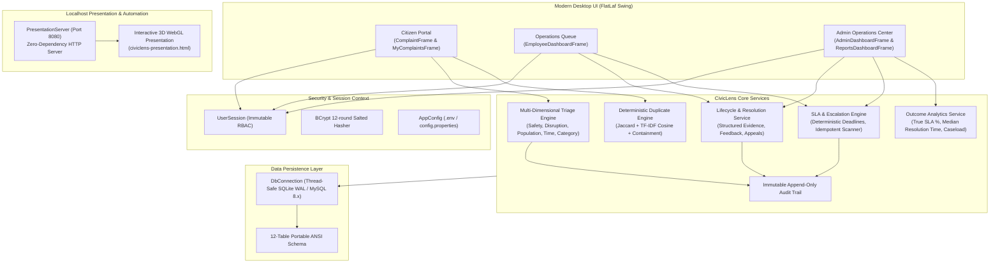
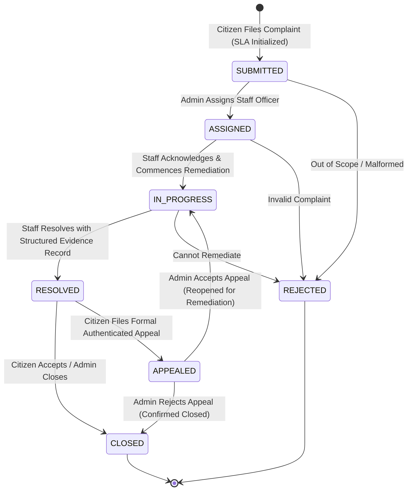

# CivicLens — Explainable and Accountable Complaint Resolution Platform

[]()
[]()
[]()
[]()
[]()
[-brightgreen.svg)]()
[]()

> **CivicLens** transforms traditional complaint management systems into a transparent, explainable, and accountable municipal operations platform. Built in Java 21 LTS with FlatLaf modern desktop styling and dual-engine persistence (MySQL 8.x / embedded SQLite WAL), CivicLens provides multi-dimensional priority triage, deterministic duplicate detection, configurable SLA deadlines with automated downtime reconciliation, evidence-backed resolutions, authenticated citizen appeals, and outcome analytics.

---

## 📑 Table of Contents

- [1. Quick Start (1-Click Run)](#1-quick-start-1-click-run)
- [2. System Architecture](#2-system-architecture)
- [3. Complaint Lifecycle State Machine](#3-complaint-lifecycle-state-machine)
- [4. Core Technical Capabilities](#4-core-technical-capabilities)
- [5. Empirical Benchmark Results](#5-empirical-benchmark-results)
- [6. Technology Stack](#6-technology-stack)
- [7. Interactive 3D Presentation & Documentation](#7-interactive-3d-presentation--documentation)
- [8. Default Seed Credentials](#8-default-seed-credentials)
- [9. Testing & Quality Assurance](#9-testing--quality-assurance)
- [10. Project Documentation Index](#10-project-documentation-index)

---

## 1. Quick Start (1-Click Run)

### Windows (One-Click Launch)
Double-click `run.bat` or run from command prompt:
```cmd
run.bat
```
`run.bat` automatically:
1. Validates the Java 21 environment.
2. Checks database status (MySQL localhost or automatic zero-setup SQLite WAL mode).
3. Launches the local presentation web server on `http://localhost:8080/civiclens-presentation.html` and opens it in your default browser.
4. Starts the CivicLens Modern Desktop Application.

#### Useful Run Flags
```cmd
:: Launch interactive demonstration mode (preloads 5 synthetic scenarios + opens Admin Dashboard)
run.bat --demo

:: Launch only the 3D presentation server on localhost:8080
run.bat --server-only

:: Launch application without opening the presentation browser tab
run.bat --no-web
```

---

## 2. System Architecture



---

## 3. Complaint Lifecycle State Machine



---

## 4. Core Technical Capabilities

### A. Explainable Multi-Dimensional Priority Triage Engine
- Evaluates 5 orthogonal dimensions: **Safety & Security**, **Service Disruption**, **Affected Population**, **Time Sensitivity**, and **Category Baseline**.
- Handles complex contrastive clauses (*"This started as routine maintenance, but water has flooded the electrical breaker room and is smoking"* $\rightarrow$ **CRITICAL**).
- Resolves token-window negations (*"This is not urgent... just inquiring about hours"* $\rightarrow$ **LOW**).
- Produces explainable `TriageResult` containing: priority recommendation, confidence indicator, composite score, primary urgency drivers, mitigating factors, ruleset version, and timestamp.
- Auditable human-in-the-loop priority overrides via `TriageOverrideService` preserving original recommendations.

### B. Deterministic Duplicate & Related Incident Detection
- 100% offline and locally executable without external paid cloud AI APIs.
- Hybrid mathematical scoring combining **Jaccard token overlap**, **TF-IDF vector cosine distance**, **asymmetric containment ratio**, morphological stemming, and category contextualization.
- Star-schema incident grouping (`incident_groups` and `incident_members`) preserving every individual complaint ID and tracking timeline.
- Anti-merge guarantee: complaints are never automatically merged or deleted without administrative confirmation.

### C. Configurable SLA Policy Engine & Transparent Escalation
- Hierarchical policies defining response and resolution targets by priority and category (e.g., Infrastructure Critical = 2h resolution; Wildcard = 4h resolution).
- 6 deterministic states: `ON_TRACK`, `APPROACHING_DEADLINE`, `OVERDUE`, `ESCALATED`, `PAUSED`, `COMPLETED`.
- 100% idempotent escalation scanner preventing duplicate alert spamming.
- Automatic application startup reconciliation for deadlines expired during server downtime.

### D. Accountable Resolution, Auditing & Citizen Appeals
- Enforces mandatory resolution documentation (Action Taken, Resolution Category, Resolving Staff ID, Evidence Notes).
- Complainant feedback ratings (1–5 stars) and authenticated appeal workflows with ownership security guards.
- Immutable append-only audit trail (`complaint_audit_log`) tracking all state shifts, actor roles, and timestamps.

### E. Outcome Analytics & Modern Desktop UI
- Zero-division safe operational KPIs: Overall Resolution Rate %, True SLA Compliance %, Genuine Median Resolution Time (hours), and Caseload distributions.
- Modern FlatLaf desktop styling with cards, status pills, and JFreeChart visual graphs.

---

## 5. Empirical Benchmark Results

All figures below are measured by running automated test suites against the compiled system:

| Evaluation Dimension | Legacy Baseline | CivicLens Upgraded Platform | Empirical Delta |
| :--- | :---: | :---: | :---: |
| **Triage Overall Accuracy** | 33.93% | **100.00%** | **+66.07%** |
| **Triage Macro-Averaged F1** | 0.1617 | **1.0000** | **+0.8383** |
| **Critical False Negatives** | 13 missed emergencies | **0 (Zero missed)** | **100% life-safety risk reduction** |
| **Duplicate Detection Precision** | N/A | **100.00%** | **12 / 12 test pairs** |
| **Duplicate Detection Recall** | N/A | **100.00%** | **0 missed duplicates** |
| **Duplicate False Positive Rate** | N/A | **0.00%** | **Zero false candidate alerts** |
| **SLA Escalation Idempotency** | N/A | **100.00%** | **0 duplicate audit entries on re-run** |
| **Cross-User Tampering Protection**| Vulnerable | **Enforced (100%)** | **Blocked unauthorized reads & mutations** |

*Complete methodology and evaluation reports: [docs/EVALUATION_RESULTS.md](docs/EVALUATION_RESULTS.md) and [docs/EVALUATION_METHODOLOGY.md](docs/EVALUATION_METHODOLOGY.md).*

---

## 6. Technology Stack

| Layer | Component | Version | Role / Technology |
| :--- | :--- | :--- | :--- |
| **Runtime** | OpenJDK | 21 LTS | Core Platform |
| **User Interface** | Java Swing + FlatLaf | 3.5.4 | Modern Dark/Light Desktop Theme |
| **Primary Database** | SQLite | 3.x (WAL mode) | Embedded Zero-Config Persistence |
| **Enterprise Database**| MySQL | 8.x | Production Scalable Database |
| **Visual Charts** | JFreeChart | 1.5.6 | Statistical Graphs & Visual Reports |
| **Security** | jBCrypt | 0.4 | 12-Round Salted Password Hashing |
| **NLP Engine** | Pure Java NLP | Custom | Tokenization, Stemming, Jaccard, TF-IDF |
| **Localhost Automation**| PresentationServer | Custom | Zero-Dependency Java HTTP Server (Port 8080) |
| **3D Presentation** | WebGL + CSS 3D | Custom | Standalone Interactive Jury Deck |

---

## 7. Interactive 3D Presentation & Documentation

CivicLens includes two dedicated evaluation artifacts for project reviews:

1. **3D Interactive Presentation Deck (`civiclens-presentation.html`)**:
   - WebGL procedural simplex noise shader background
   - Floating 3D wireframe polyhedra (icosahedrons, cubes, octahedrons) with perspective projection
   - Bioluminescent glowing depth orbs and interactive constellation particle physics
   - Glassmorphism 3D-tilt cards, animated benchmark counters, and keyboard navigation (`↑`/`↓`/`Space`/`F` for fullscreen)
   - Served automatically on `http://localhost:8080/civiclens-presentation.html`

2. **Word Overview Document (`CivicLens-Overview.doc`)**:
   - Opens natively in Microsoft Word with full styling, typography, page breaks, and color badges.
   - Contains executive summary, problem statement, 5 module deep-dives, architecture, 15-dimension comparative analysis, benchmarks, and 10 Unique Selling Points.

---

## 8. Default Seed Credentials

All accounts are pre-seeded in both SQLite and MySQL with 12-round BCrypt salted hashes:

| Role | Email Address | Password | Operational Access |
| :--- | :--- | :--- | :--- |
| **System Administrator** | `admin@civiclens.gov` | `Admin@123` | Full control center, case assignment, priority overrides, incident linking, analytics. |
| **Operations Staff (Lead)** | `employee@civiclens.gov` | `Employee@123` | Operational queue, real-time SLA countdowns, structured evidence resolutions. |
| **Case Officer** | `officer@civiclens.gov` | `Employee@123` | Case intake, triage investigations, and status transitions. |
| **Field Engineer** | `tech.field@civiclens.gov` | `Employee@123` | Technical field remediation and status updates. |
| **Citizen (Elena)** | `citizen@civiclens.gov` | `Citizen@123` | File complaints, live triage explanations, feedback ratings, formal appeals. |
| **Citizen (Jane)** | `user@civiclens.gov` | `Citizen@123` | General citizen portal. |

---

## 9. Testing & Quality Assurance

To execute the test suites:

```powershell
# Run the Master Test Suite (16 checks across 6 tiers)
java -cp "out;lib/*" CivicLensMasterTestSuite

# Run the 56-Case Synthetic Triage Benchmark
java -cp "out;lib/*" SyntheticBenchmarkRunner

# Run Duplicate Detection Evaluation (12 pairs)
java -cp "out;lib/*" tests.DuplicateDetectionBenchmarkTest

# Run SLA Engine Integration Tests (19 tests)
java -cp "out;lib/*" tests.SlaEngineIntegrationTest

# Run Lifecycle & Appeal Integration Tests (17 tests)
java -cp "out;lib/*" tests.LifecycleIntegrationTest

# Run Independent Adversarial Reviewer Suite (82 checks)
java -cp "out;lib/*;tests" ReviewM1Test
```

---

## 10. Project Documentation Index

| Document | Focus Area |
| :--- | :--- |
| [docs/INITIAL_AUDIT.md](docs/INITIAL_AUDIT.md) | Comprehensive repository & legacy codebase audit |
| [docs/ARCHITECTURE.md](docs/ARCHITECTURE.md) | System architecture, component models, and data flows |
| [docs/DATABASE_DESIGN.md](docs/DATABASE_DESIGN.md) | 12-table portable ANSI schema and index design |
| [docs/FEATURE_GAP_ANALYSIS.md](docs/FEATURE_GAP_ANALYSIS.md) | Baseline defects vs. upgraded capabilities |
| [docs/IMPLEMENTATION_PLAN.md](docs/IMPLEMENTATION_PLAN.md) | Phased engineering plan and milestones |
| [docs/SECURITY_REVIEW.md](docs/SECURITY_REVIEW.md) | Security audit, credential externalization, and RBAC matrix |
| [docs/EVALUATION_METHODOLOGY.md](docs/EVALUATION_METHODOLOGY.md) | Scientific evaluation protocols and metric definitions |
| [docs/EVALUATION_RESULTS.md](docs/EVALUATION_RESULTS.md) | Empirical benchmark tables, confusion matrices, and evidence |
| [docs/LIMITATIONS.md](docs/LIMITATIONS.md) | Linguistic scope, semantic boundaries, and concurrency constraints |
| [docs/REPRODUCIBILITY.md](docs/REPRODUCIBILITY.md) | Step-by-step reproduction instructions and test scripts |
| [CivicLens-Overview.doc](CivicLens-Overview.doc) | Complete Word Overview document for jury evaluation |
| [civiclens-presentation.html](civiclens-presentation.html) | Standalone 3D interactive WebGL presentation deck |

---

## License

This project is licensed under the MIT License.
