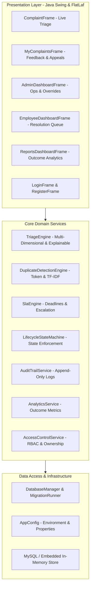

# CivicLens Architecture & System Design

## 1. High-Level Architectural Model

CivicLens upgrades the Smart Complaint Management System into a layered, explainable, and accountable architecture preserving the Java Swing presentation layer and JDBC persistence while introducing decoupled domain services:

---

## 2. Component Responsibilities

### 2.1 Presentation Layer (`src/civiclens/ui/` & modernized `src/*.java`)
- **Modernized Look & Feel**: Uses FlatLaf for cohesive visual hierarchy, clean card panels, accessible contrast, and responsive table views.
- **Explainability Views**: Live feedback explaining why a complaint was classified at a given priority, highlighting urgency drivers and reducers.
- **Incident Linking Panel**: Displays potential duplicate candidates with similarity scores and matching rationale for human confirmation.
- **Resolution Dialog**: Requires action taken, resolution category, and notes before allowing completion.

### 2.2 Service Layer (`src/civiclens/core/`)
- **TriageEngine**: Evaluates 5 dimensions: (1) Safety/Security, (2) Service Disruption, (3) Affected Scope, (4) Time Sensitivity, and (5) Category Context. Handles negation and contradictory clauses.
- **DuplicateDetectionEngine**: Computes token overlap (Jaccard) and TF-IDF cosine similarity between complaint titles and descriptions offline.
- **SlaEngine**: Calculates response and resolution deadlines from configurable policy tables; determines SLA status (`ON_TRACK`, `APPROACHING_DEADLINE`, `OVERDUE`, `ESCALATED`).
- **LifecycleStateMachine**: Validates legal status transitions:
  `SUBMITTED` $\rightarrow$ `ASSIGNED` $\rightarrow$ `IN_PROGRESS` $\rightarrow$ `RESOLVED` $\rightarrow$ `CLOSED` (or `REOPENED`/`APPEALED`).
- **AuditTrailService**: Emits immutable audit records for all security-sensitive actions and lifecycle state changes.
- **AccessControlService**: Enforces role restrictions (`ADMIN`, `EMPLOYEE`, `USER`) and record ownership checks.

### 2.3 Data Access Layer (`src/civiclens/data/`)
- **DatabaseManager**: Manages connection pooling, transactions, and fallback between production MySQL and embedded/in-memory test database.
- **MigrationRunner**: Executes versioned SQL migrations (`db/migrations/V1__initial.sql`, `V2__civiclens_schema.sql`).
